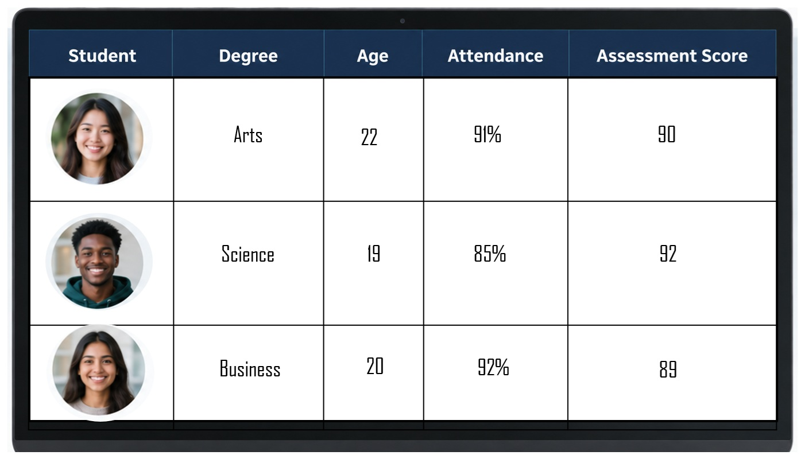
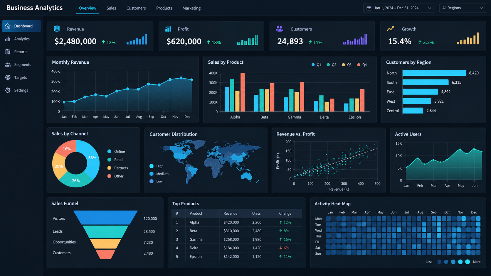
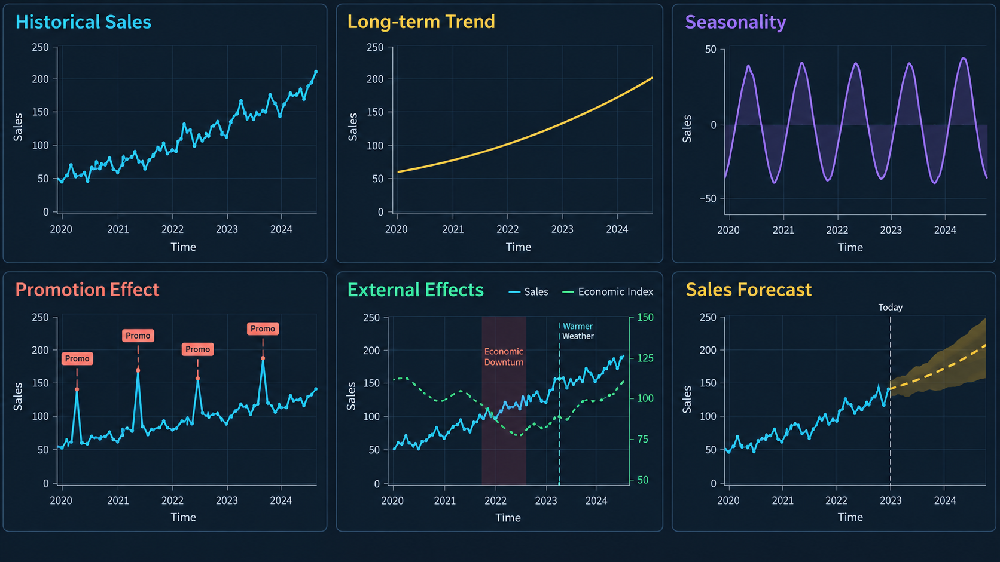
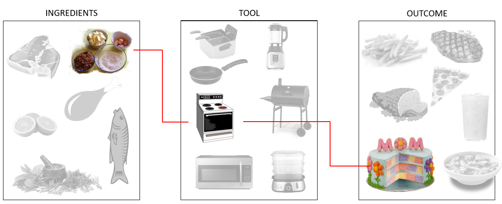
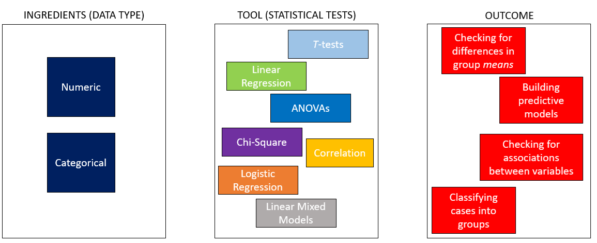

```{r}
library(tidyverse)
library(gt)
```


## What is Statistics?

For many people, the first things that come to mind are numbers, formulas, calculations, tables and complicated-looking graphs. You might think of averages, percentages, opinion polls or sporting records. Some people may remember a mathematics class—and perhaps not particularly fondly.

These are all connected to statistics, but they do not capture what statistics is really about. Statistics is not simply the calculation of numbers. It is the process of using data to answer questions, learn about the world and make decisions when we do not have complete information.

For example:

- Is a new advertising campaign increasing sales?
- Which customers are most likely to stop using a service?
- Does a new medical treatment work?
- Is a change in customer satisfaction meaningful, or could it simply be random variation?
- What is likely to happen in the future?

The calculations help us investigate these questions, but they are not the final objective. The objective is to turn data into evidence—and evidence into informed decisions. So, throughout this unit, I do not want you to think of statistics as a collection of formulas to memorise. Instead, think of statistics as a way of reasoning:

> How can we use the information we have to make the best possible decision, while recognising that we can never be completely certain?

## Why Statistics?

One of the first questions I like to ask when I take on a new unit is:

> *Why this unit*?

In this case ... why is statistics a core part of your degree?

For those majoring in econometrics or business analytics, the answer might seem obvious. But many of you come from other sub-disciplines—marketing, management, banking and finance, etc., — and yet, you're all required to study statistics.

So what is it about statistics that makes it essential across so many fields? To answer this question, read the case study regarding the NASA Challenger Disaster below.

::: callout-tip
## The NASA Challenger disaster

On January 28, 1986, the space shuttle **Challenger** broke apart just 73 seconds after liftoff, killing all seven astronauts on board. The tragedy remains one of the most devastating examples of how misunderstanding data and poor statistical reasoning can have fatal consequences.

<center></center>

<br>

Prior to the launch, engineers from Morton Thiokol, the contractor responsible for the shuttle’s O-ring seals, were concerned about the effects of cold temperature on the O-rings’ ability to prevent hot gases from escaping during launch. They had data from previous shuttle launches showing the number of O-ring failures (or "erosions") and the temperature at launch.

```{r, include=FALSE}

df_space <- 
  data.frame(
    x = c(53,56,57,63,70,75),
    y = c(3,1,1,1,1,2)
  )
```

```{r}
df_space |> 
  ggplot(aes(x,y)) +
  theme_bw() +
  geom_point(size = 3) +
  ylim(0,4) +
  scale_x_continuous(limits = c(50,80),
                     breaks = seq(50,80, by = 5)) +
  ylab("Number of Failures") +
  xlab("Temperature (F) on launch day")
```

Unfortunately, when Thiokol engineers presented their findings to NASA, the data were plotted incorrectly. They graphed the number of O-ring failures only for the launches that had experienced a failure—completely omitting all the launches where there were *no* failures. This meant that the plot showed no clear pattern, appearing to suggest that O-ring performance was random and unrelated to temperature. If the engineers had instead plotted all launches—including those with zero O-ring problems—against temperature (see plot below), the relationship would have been obvious:

> as the temperature dropped, the probability of O-ring failure increased sharply.

```{r, include=FALSE}
library(tidyverse)
df_space2 <- 
  data.frame(
    x = c(53,56,57,63,70,75, 64,65,66,67,70,73,74,76,77,78,79),
    y = c(3,1,1,1,1,2, 0,0,0,0,0,0,0,0,0,0,0)
  )
```

```{r}
df_space2 |> 
  ggplot(aes(x,y)) +
  theme_bw() +
  geom_point(size = 3) +
  ylim(0,4) +
  scale_x_continuous(limits = c(50,80),
                     breaks = seq(50,80, by = 5)) +
  ylab("Number of Failures") +
  xlab("Temperature (F) on launch day") +
   geom_smooth(
    method = "nls",
    formula = y ~ a * exp(-b * x),
    method.args = list(start = list(a = 3, b = 0.05)),
    se = FALSE,
    color = "blue"
  )
```

The Challenger launch occurred at 51°F, far colder than any previous launch, placing it in the highest-risk zone of all.

Despite engineers’ warnings and uncertainty, NASA decided to proceed with the launch under immense schedule and political pressure. The misunderstanding of the statistical evidence—and the lack of clear data visualization—played a major role in the decision. When the Challenger lifted off, the cold temperature caused one of the O-rings to fail, leading to the explosion that destroyed the shuttle.

In short, if the data had been plotted correctly, the evidence against launching in such cold conditions would have been undeniable. Tragedy might have been averted through better understanding and communication of statistical relationships.
:::

So I come back to the question:

> Why statistics?

Not everyone here is going to work at NASA or be in a role where your decisions could cost lives.

However, every one of you will be expected to make **decisions using data** — whether you're managing a budget, launching a product, analyzing customer feedback, or pitching a new strategy to stakeholders. Inaccurate assumptions, poor interpretation of trends, or blindly trusting a single number without questioning where it came from—these mistakes won’t make the news like the Challenger disaster did, but they can cost your company money, credibility, or opportunity. And more importantly, they can damage your own confidence and reputation as a professional.

Statistics helps you avoid that. It teaches you not just how to calculate but how to think: how to challenge claims, test assumptions, and make sense of messy real-world data. That’s why this unit matters — not just for your degree, but for your ability to make smarter, more informed decisions, wherever your career takes you.

## Modern Statistics

In the past, learning statistics often had a strong focus on numbers, formulas, calculations and mathematical proofs. And whilst these foundations are still important, modern statistics is about much more than performing calculations. Modern statistics focuses on using data and analytics to answer questions, understand uncertainty and make better decisions. In particular, modern statistics has a large focus on making decisions with data. For example:

- What Data do we need?
- How to collect the Data?
- Which methods are appropriate for analysing the Data?
- What conclusions can we make with the Data?

Given this focus on data, we should then ask the question:

> What is data?

::: callout-note

## Data, cases and variables

Data are recorded pieces of information about people, objects, events or processes. 

- The people, objects or events we collect information about are often called **cases, observations or units**.
- The characteristics recorded for each case are called **variables**.
  
:::


For example, a university might record data about its students, including their degree, age, attendance and assessment results. Here the students would be the cases, and the following could be variables:

- Degree
- Age
- Attendance rate
- Exam score

When we analyse data, we need to begin by having it in a tabular format. A good data table will have the information organised where each row represents one case, and each column is one variable.

<center></center>

<br>

In the image above, each student is a case, and they are represented by a single row. The columns, Degree, Age, Attendance and Assessment Score are specific to each case. For example, we can say that for case 1, the student is:

- Studying an Arts Degree
- Is 22 years old
- Has an attendance rate of 91%
- Has an Assessment Score of 90

## Where does data come from?

### Primary Data

Data can come from many different sources. For example a researcher

- might conduct a survey to understand people’s attitudes towards public transport
- or they might run an experiment to compare the effectiveness of two medications.

In these two examples, the data collected would be considered **primary data** because the researcher is directly involved in collecting it.

### Secondary Data

Other data already exist because they were originally collected for another purpose. A researcher might use government census data, hospital records, company sales data or information from an existing database. This is often called secondary data.

### Common sources of data

Common sources of data include:

```{r}
tibble(
  Type = c("Surveys and Questionnaires",
           "Experiments",
           "Observational studies",
           "Administrative records",
           "Business transactions",
           "Sensors and devices",
           "Digital activity"),
  
  Description = c("People report their opinions, behaviours or characteristics",
                  "Researchers deliberately change something and observe the outcome",
                  "Researchers observe what occurs without directly intervening",
                  "such as enrolment records, tax records and medical records",
                  "including purchases, payments and customer interactions",
                  "such as fitness trackers, weather stations, satellites and GPS devices",
                  "including website visits, online searches and interactions with apps or social media")
) |> 
  gt()
```

The source of the data matters because data are not simply neutral facts that appear on their own. 
Someone has decided what to measure, how to measure it, whom to include and when to collect it.

## What do we do with data?

Data allow us to learn about the world by turning observations into useful information. We can begin by describing what has been observed. Tables, graphs and summary measures can help us identify typical values, understand how much observations vary and recognise unusual cases. For example, a business might use its sales data to determine which products sell most frequently, calculate average customer spending and identify periods of unusually high or low demand.

<center></center>

<br>

We can also use data to compare groups and investigate relationships between variables. A university might compare assessment results across different teaching methods, while a business might examine whether advertising expenditure is related to sales. These analyses can reveal important patterns, although an observed relationship does not necessarily mean that one variable causes the other.

Data can also help us make predictions. Patterns observed in existing data can be used to estimate an unknown or future outcome. A retailer might predict future demand, a bank might estimate the likelihood that a customer will default on a loan, or a hospital might predict whether a patient is at risk of readmission. Predictions will rarely be perfectly accurate, so it is also important to describe the uncertainty associated with them.

<center></center>

<br>

Finally, data allow us to draw conclusions beyond the observations immediately available to us. It is often impractical to collect information from every customer, resident or patient. Instead, we collect data from a sample and use statistical inference to learn about the wider population. This may involve estimating an unknown population value or testing whether the available evidence supports a particular claim.

These activities ultimately support better decision-making. Data do not make decisions by themselves, and a large dataset does not automatically produce a reliable conclusion. We must still consider how the data were collected, whether they are representative, whether the measurements are trustworthy and whether alternative explanations are possible. Statistics provides the tools needed to turn data into evidence while recognising the uncertainty and limitations that remain.

## Variables

### What is a variable?

A variable is a characteristic or measurement that can take different values across observations.

The observations might be people, businesses, products, countries or points in time. For example, in a dataset containing information about students, each row might represent one student and each column might represent a variable.

| Student | Study time (hours) | Test score |
|:-------:|-------------------:|-----------:|
| 1       | 2.0                | 58         |
| 2       | 4.5                | 76         |
| 3       | 6.0                | 84         |
| 4       | 3.0                | 65         |

In this dataset:

- Student identifies each observation;
- Study time is a variable recording how many hours each student studied;
- Test score is a variable recording each student's result.

They are called variables because their values can vary.

### Variation between and within people

The amount of studying and the test score can vary from one student to another. One student might study for two hours, while another might study for six hours. Their test scores may also differ.

Variables can also change for the same person over time. A student might study for five hours for one test but only two hours for another. The same student may obtain different scores across different assessments.

Therefore, variation can occur:

- between people, because different students may have different values;
- within a person, because the same student's value may change over time.

If students are observed on several occasions, the dataset might look like this:

| Student | Test | Study time (hours) | Test score |
|:-------:|:----:|-------------------:|-----------:|
| 1       | 1    | 2.0                | 58         |
| 1       | 2    | 4.0                | 72         |
| 2       | 1    | 5.0                | 79         |
| 2       | 2    | 3.5                | 68         |

In this dataset, each row represents a particular student completing a particular test. The same student can therefore appear in more than one row. Recognising what each row represents is important when interpreting a dataset.

### Levels of measurement

Variables can be classified according to their level of measurement. The four commonly used levels are:

1. nominal;
2. ordinal;
3. interval;
4. ratio.

The level of measurement tells us what the recorded values mean and which comparisons are appropriate.

#### Nominal variables

A nominal variable places observations into categories that do not have a natural order. The values may be recorded using words or numerical codes, but they function only as labels.

In the student scenario, nominal variables might include:

- study method: Individual, Group or Tutor;
- degree: Business, Arts or Science;
- test format: Online or In person;
- student identification number.

There is no meaningful way to arrange these study methods from lowest to highest. One category is not inherently greater than another.

A nominal variable can also be represented using numbers:

1 = Individual;
2 = Group;
3 = Tutor.

However, these numbers remain category labels. It would not make sense to calculate the average study method or claim that Tutor is three times Individual.


#### Ordinal variables

An ordinal variable places observations into categories that have a meaningful order. However, the distance between consecutive categories is not necessarily equal.

In the student scenario, students might report their level of preparation as:

- Very low;
- Low;
- Moderate;
- High;
- Very high.

A student reporting High preparation indicates more preparation than a student reporting Low preparation. However, we cannot assume that the difference between Low and Moderate is exactly the same as the difference between High and Very high.

Other ordinal variables in this scenario might include:

- confidence before the test: Low, Medium or High;
- letter grade: F, D, C, B or A;
- class ranking;
- agreement with the statement "I was well prepared": from Strongly disagree to Strongly agree.

Ordinal values allow us to compare order, but not necessarily the exact size of the differences between categories.

#### Interval variables

An interval variable is numerical, ordered and measured using equal intervals. A difference of one unit has the same meaning throughout the scale. However, an interval variable does not have a true zero representing the complete absence of the characteristic.

A standardised test score can sometimes be treated as an interval variable. For example, the difference between standardised scores of 50 and 60 is interpreted in the same way as the difference between 70 and 80.

However, a score of zero does not necessarily mean that the student has no knowledge or ability. Consequently, it would not usually be meaningful to say that a student with a standardised score of 80 has twice the ability of a student with a score of 40.

#### Ratio variables

A ratio variable has all the properties of an interval variable, together with a meaningful true zero. A value of zero indicates the absence of the quantity being measured. This means that both differences and ratios can be interpreted meaningfully.

In the student scenario, the amount of time spent studying is a ratio variable:

- zero hours means that no time was spent studying;
- four hours is two hours more than two hours;
- four hours is twice as much study time as two hours.

Other ratio variables in this scenario might include:

- number of practice questions completed;
- number of classes attended;
- number of correct answers;
- time taken to complete the test;
- number of days spent preparing.

### Comparing the four levels

| Level    | Categories ordered? | Equal intervals? | True zero? | Student example         |
|:---------|:-------------------:|:----------------:|:----------:|:------------------------|
| Nominal  | No                  | No               | No         | Study method            |
| Ordinal  | Yes                 | No               | No         | Preparation level       |
| Interval | Yes                 | Yes              | No         | Standardised test score |
| Ratio    | Yes                 | Yes              | Yes        | Study time in hours     |

The levels form a progression in the amount of information they provide:

$$
\text{Nominal} \longrightarrow \text{Ordinal} \longrightarrow \text{Interval} \longrightarrow \text{Ratio}
$$

However, a higher level is not automatically better. The appropriate level depends on what is being measured and how it has been recorded.

The level of measurement matters because it influences:

- how a variable should be summarised;
- which graphs are appropriate;
- which mathematical operations are meaningful;
- which statistical analyses can be used.

For example, calculating an average is meaningful for study time, but not for study method. Similarly, a bar chart may be suitable for study method, while a histogram may be more appropriate for study time or test scores.

## Cooking

> Statistics is a lot like cooking.

Suppose I want to bake a cake for Mother’s Day.

1.  First, I prepare the ingredients.
2.  Then, I cook them — in this case, using an oven.
3.  Finally, I (hopefully) end up with the desired end product: a cake.

Now imagine that instead of using an oven, I decided to use a deep fryer. Would I still get a cake? Probably not! The same goes for using a steamer, a blender, or a grill — each appliance is designed for a specific purpose and produces a different result.

To make a good cake, I need both the right ingredients and the right tool. Using the wrong one can lead to an unexpected or flawed outcome.



The same principle applies in statistics. Our tools are the various statistical tests and models available to us. Each is suited to a particular type of problem or research question. Our ingredients are the data we have — their type, structure, and quality.



If we use the wrong statistical tool for the data at hand, our results may be misleading or invalid, just like trying to bake a cake in a deep fryer.

### The Ingredients: Variables

In statistics, our ingredients are called **variables**. A variable is simply something that can vary — it can take on different values across people, objects, or situations. For example,

-   If we’re studying athletes, variables might include height, training hours, or reaction time.
-   In a business context, they might be sales revenue, customer satisfaction, or number of website visits.

Some variables are numeric — they involve numbers that can be measured (like weight or income). Others are categorical, describing qualities or groups (like gender, position played, or brand preference). Knowing which kind of variable we have is like knowing whether we’re working with flour or sugar — it determines what “statistical recipe” we should follow.

If we treat every variable the same way, we might end up “deep-frying” our data instead of baking it. The secret to good statistical practice is understanding what each variable represents and choosing the right method to work with it.

## Explanatory and outcome variables

When investigating a relationship, variables are often described according to the role they play in the research question.

- An **outcome variable** is the variable we want to understand, explain or predict. It represents the result of interest.

- An **explanatory variable** is a variable that may help explain or predict variation in the outcome variable.

Suppose we want to investigate whether students who spend more time studying tend to obtain higher test scores. In this question:

- Study time is the explanatory variable.
- Test score is the outcome variable.

The explanatory variable is sometimes called the predictor, independent variable or input variable. The outcome variable may also be called the response, dependent variable or target variable.

These labels describe the role of each variable in a particular analysis. They are not permanent characteristics of the variables themselves. The same variable may be an outcome in one research question and an explanatory variable in another.

It is also important to remember that an association between an explanatory variable and an outcome variable does not necessarily establish that one causes the other. We will examine relationships, prediction and causation in more detail in later chapters.

## Workshop Exercises

### Background

You are working as a data analyst investigating business performance. Different teams have supplied information about 300 businesses across several Excel sheets. Your task is to bring this information together into one table. You will use the completed dataset in activities over the coming weeks.

### The Data

There are 5 data sources that you will need to download and merge. Each business has a unique identifier, `business_id`, which connects its information across sheets. Businesses may appear in different row orders on different sheets.

```{r setup-downloads, include=FALSE}
library(downloadthis)
```

<style>
.download-table {
  width: 100%;
  max-width: 650px;
  margin: 20px auto;
  border-collapse: collapse;
}
.download-table th {
  background: #243c59;
  color: white;
  padding: 12px 18px;
  text-align: left;
}
.download-table td {
  padding: 12px 18px;
  border-bottom: 1px solid #dde3ea;
  vertical-align: middle;
}
.download-table tbody tr:nth-child(even) {
  background: #f3f6f9;
}
.download-table th:last-child,
.download-table td:last-child {
  text-align: left;
}
</style>

<table class="download-table">
<thead>
<tr>
<th>Dataset</th>
<th>Download</th>
</tr>
</thead>
<tbody>
<tr>
<td>Technology businesses</td>
<td>

```{r download-tech, echo=FALSE}
download_file(
  path = "data/Tech.xlsx",
  button_label = "Tech",
  button_type = "success"
)
```

</td>
</tr>
<tr>
<td>Financial information</td>
<td>

```{r download-finance, echo=FALSE}
download_file(
  path = "data/Finance.xlsx",
  button_label = "Finance",
  button_type = "success"
)
```

</td>
</tr>
<tr>
<td>Hospitality businesses</td>
<td>

```{r download-hospitality, echo=FALSE}
download_file(
  path = "data/Hospitality.xlsx",
  button_label = "Hospitality",
  button_type = "success"
)
```

</td>
</tr>
<tr>
<td>Marketing and technology information</td>
<td>

```{r download-marketing, echo=FALSE}
download_file(
  path = "data/Marketing_and_technology.xlsx",
  button_label = "Marketing",
  button_type = "success"
)
```

</td>
</tr>
<tr>
<td>Retail businesses</td>
<td>

```{r download-retail, echo=FALSE}
download_file(
  path = "data/Retail.xlsx",
  button_label = "Retail",
  button_type = "success"
)
```

</td>
</tr>
</tbody>
</table>

### Your Task

Create a workbook called Combined data, containing one table with one row per business and one column per variable.

1. **Inspect the seperate workbooks.** Identify the column headings, the information recorded and the number of businesses in each sheet.
2. **Combine the business profiles.** Copy the records from Retail, Hospitality and Tech into your new workbook, using one header row. Add a Sector column to identify each business’s industry.
3. **Match the remaining information.** Use `business_id` to bring across the corresponding information from Finance and Marketing and technology. Use an Excel lookup function, such as VLOOKUP, to match records.
4. **Format the completed table.** Convert the combined data into an Excel Table. Use clear column headings and appropriate number formats. Retain the units supplied and ensure that negative profits are displayed correctly.
5. **Check your work.** Confirm that your table contains:
    - 300 businesses and 12 columns.
    - One unique business_id per row, with no duplicates.
    - No blank cells or lookup errors.
    - Correctly matched information for at least three businesses, checked against the original sheets.


### Exploring your business dataset

Complete these questions after combining the five datasets in Excel.

::: {.callout-note}
## Question 1: What does the table represent?

a. What does one row in your completed table represent?

b. How many observations and variables does your table contain?

c. What is the purpose of `business_id`? Would calculating the average business ID be meaningful?

d. Explain how a duplicated business could affect your analysis.
:::

::: {.callout-tip collapse="true"}
## Solution

a. Each row represents one business.

b. There are **300 observations** and **12 columns**, including the business identifier.

c. `business_id` uniquely identifies each business and allows its records to be matched across files. Its digits are labels, so calculating their average would have no meaningful interpretation.

d. A duplicated business would be counted more than once. This could distort counts, percentages and averages by giving that business extra weight.
:::

::: {.callout-note}
## Question 2: What kinds of variables do we have?

Classify each variable below as **categorical** or **numerical**, and identify its **level of measurement**.

- Sector
- Brand recognition
- Has online store
- Years in business
- Number of employees

Explain why coding brand recognition as Low = 1 and High = 2 would not make it a numerical measurement.
:::

::: {.callout-tip collapse="true"}
## Solution

| Variable | Type | Level of measurement |
|---|---|---|
| Sector | Categorical | Nominal |
| Brand recognition | Categorical | Ordinal |
| Has online store | Categorical | Nominal |
| Years in business | Numerical | Ratio |
| Number of employees | Numerical | Ratio |

Sector and online store status have categories without a natural ranking. Brand recognition has ordered categories: Low comes before High.

Years in business and employee count have meaningful zeros. For example, 40 employees is twice as many as 20 employees.

Coding Low = 1 and High = 2 only assigns numbers to category labels. It does not establish that High represents twice as much brand recognition as Low.
:::

::: {.callout-note}
## Question 3: Where did the data come from?

Imagine that these records came from a business association's existing database.

a. Would using these records for your project be an example of primary or secondary data?

b. Identify three questions you would ask the association before analysing the data.

c. Would having records for 300 businesses automatically allow you to draw conclusions about all businesses in Australia? Explain.
:::

::: {.callout-tip collapse="true"}
## Suggested solution

a. These would be **secondary data**, because you are using existing records rather than collecting the information yourself.

b. Useful questions include:

- How were the businesses selected?
- When were the measurements recorded?
- How were profit, complaint rate and brand recognition defined and measured?
- Do all financial figures refer to the same time period?
- Were any businesses excluded?

c. No. The number of businesses alone does not establish whether they represent Australian businesses generally. For example, association members may differ from non-members, and the dataset contains only three industry sectors.
:::

::: {.callout-note}
## Question 4: Turn an idea into a statistical question

A business adviser asks:

> "Does having an online store make a difference?"

a. Rewrite this as a clear statistical question that could be investigated using your dataset.

b. Identify the outcome variable and explanatory variable.

c. Describe a table or graph that could help investigate your question.

d. Would describing the 300 businesses and drawing a conclusion about a wider population be the same task?
:::

::: {.callout-tip collapse="true"}
## Suggested solution

One suitable question is:

> "Do businesses with an online store have a higher average profit than businesses without an online store?"

- **Outcome variable:** Profit.
- **Explanatory variable:** Online store status.
- **Possible display:** A table comparing the number of businesses and average profit in the two groups, or a graph comparing their profit distributions.

Describing these 300 businesses is **descriptive analysis**. Drawing conclusions about a wider population involves **statistical inference** and requires considering how the businesses were selected and the uncertainty in the results.

Other questions are possible, provided the outcome and comparison are clearly defined.
:::

::: {.callout-note}
## Question 5: Plan your own investigation

Choose a question that a business owner, industry association or government agency might want to answer using this dataset.

Your question must involve at least two variables.

Write a short investigation plan that includes:

a. Your statistical question.

b. The outcome variable and explanatory variable or variables.

c. A table, graph or comparison you would use.

d. A decision that your findings could help inform.

e. One additional variable you would like to collect, and why it would be useful.
:::

::: {.callout-tip collapse="true"}
## Example solution

**Question:** Is marketing expenditure associated with brand recognition?

**Outcome variable:** Brand recognition.

**Explanatory variable:** Marketing expenditure.

**Possible comparison:** Compare marketing expenditure between businesses with Low and High brand recognition.

**Decision:** The findings could help a business decide whether to investigate its marketing strategy further.

**Additional variable:** Type of marketing activity. Businesses spending similar amounts may use very different advertising channels.

Many answers are valid. A strong investigation plan uses available variables, proposes a suitable comparison and explains how the findings could inform a decision.
:::

::: {.callout-note}
## Question 6: What could we conclude?

Suppose an analysis finds that businesses using AI tools have a higher average profit.

A manager concludes:

> "Every business should adopt AI tools because AI increases profit."

a. Explain why this conclusion goes beyond the evidence described.

b. Identify two other variables in the dataset that might help explain the difference in profit.

c. Suggest a follow-up question that could be investigated using the existing data.

d. What additional evidence would strengthen the claim that adopting AI improves profit?
:::

::: {.callout-tip collapse="true"}
## Suggested solution

a. A difference in average profit shows an **association**, but does not establish that AI caused the difference. More profitable businesses might be better able to afford AI tools, or the groups might differ in other ways.

b. Possible explanations include industry sector, employee count, years in business and marketing expenditure.

c. One follow-up question is:

> "Within each industry sector, do businesses using AI tools have higher average profit than businesses that do not?"

This would help assess whether the overall difference reflects the mixture of sectors in each group.

d. Stronger evidence could come from a study that randomly assigns suitable businesses to adopt AI tools or continue their existing practices, then measures subsequent profit. Recording profit before adoption would also help establish how performance changed.
:::


