```{r}
library(tidyverse)
library(gt)
library(flextable)
library(webexercises)
```

## Introduction

In the previous chapter, we were introduced to data and variables. We considered where data come from, how they are collected and what they can be used for. We also examined different levels of measurement, including nominal, ordinal, interval and ratio variables. These distinctions are important because the type of variable determines how it can be meaningfully summarised and analysed.

We now begin our study of descriptive statistics. Descriptive statistics are methods used to: 

- organise, 
- summarise and 
- present data in a clear and informative way. 

A raw dataset may contain hundreds or thousands of observations, making it difficult to identify important patterns simply by looking at the individual values. Descriptive statistics help transform these values into information that is easier to understand.

For example, suppose we have the assessment scores of 500 students. Rather than examining every score separately, we might calculate a typical score, describe how much the scores vary, or determine how many students fall within different score ranges. We could also use tables and graphs to communicate the distribution of scores.

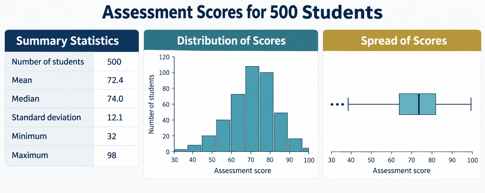<br>

The purpose of descriptive statistics is to describe the data that have been observed. They can help us answer questions such as:

- What is a typical value?
- How much do the observations differ from one another?
- Which values or categories occur most frequently?
- Are there any unusual observations?
- What patterns or relationships are visible in the data?

::: callout-caution

Descriptive statistics do not, by themselves, allow us to draw conclusions beyond the available data. Instead, they provide an important first step in understanding a dataset and often form the foundation for later statistical analysis.

:::

## Understanding Categorical data

To begin, let's examine an example with categorical data. Read through the scenario below, which relates to two categorical variables.

::: callout-note
### Exercise and Medical Conditions

Suppose we had some qualitative information on 5,000 people in Australia including information on whether the individual has been diagnosed with a particular medical condition and the amount of exercise they do.

-   Individuals were asked to indicate their primary medical condition out of; 'Asthma', 'Cancer', 'Depression’, 'Diabetes', 'Heart Disease' or 'None of Above'.
-   They were also categorised by the amount of exercise they did each week; either 'Moderate' or 'Minimal' exercise.

**Note:** In the real world, people can have multiple medical conditions at a given time. To keep this example simple, we will assume each person in this data set only has one condition.

<center>


**Source: https://www.lifelinehealthcarebd.org**

</center>
:::

### Tabular format

The table below is a snapshot of the data (showing just the first 8 people in the sample).

```{r}
df1 <- data.frame(
  'Person_ID' = c(1:8),
  Condition = c(
    "None", "Heart Disease", "Diabetes","None",
    "None", "None", "Asthma", "None"),
  Exercise = c("Moderate", "Moderate","Moderate","Moderate",
               "Minimal","Moderate","Minimal","Moderate")
  ) |> 
  regulartable() |> 
  align(j = 1, align = "center", part = "all") |> 
  autofit()
df1
```

For each person, we have collected two pieces of information: Condition and Exercise. It’s common the assign our subjects an ID number to make analysis more manageable (here: 1 to 8). Data that is arranged like the table above is considered data in **tabular format**, where each row corresponds to data for a single person. For example:

-   Person 1 has no medical conditions, and does moderate exercise.
-   Person 2 has heart disease and does moderate exercise.
-   Person 7 has asthma and does minimal exercise.

Before you do any sort of analysis, it’s important to have your data in tabular format.

### Visualising categories

It’s often a good idea to start all analyses by visualising the data. When dealing with categorical data, it’s useful to obtain the frequencies (or counts) for your variable(s) of interest.

For example, looking at our snapshot table from above, but only focusing on the `Conditon` variable, we can obtain the frequencies for each condition in this snapshot:

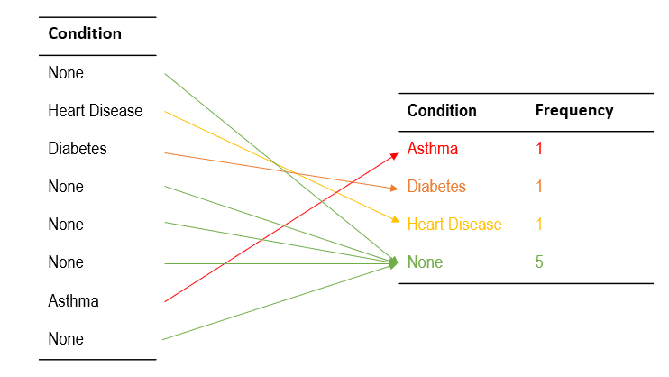


### Bar charts

Another way to visualise your data is with plots. When plotting frequencies / counts, bar charts are often a good first choice. The height of the bars represent the counts – therefore it’s easy for people to quickly look at the plot and see which groups are high / low.

```{r}
library(tidyverse)
df2 <- data.frame(
  'Person_ID' = c(1:8),
  Condition = c(
    "None", "Heart Disease", "Diabetes","None",
    "None", "None", "Asthma", "None"),
  Exercise = c("Moderate", "Moderate","Moderate","Moderate",
               "Minimal","Moderate","Minimal","Moderate")
  )
p1 <- df2 |> 
  ggplot(aes(Condition)) +
  geom_bar() +
  ylab("Frequency") +
  ylim(0,7) +
  ggtitle("Medical Condition")
p2 <- df2 |> 
  ggplot(aes(Exercise)) +
  geom_bar() +
  ylab("Frequency") +
  ylim(0,7) +
  ggtitle("Amount of Exercise")

library(patchwork)
p1+p2
```

### Percentage plots

When dealing with categorical data, sometimes it’s useful to think of things in terms of percentages (looking at the tables above, why would percentages be a bad idea for small samples)?

```{r}
df_plot <- df2 %>%
  count(Condition) %>%
  mutate(pct = n / sum(n))

p3 <- ggplot(df_plot, aes(x = "Condition", y = pct, fill = Condition)) +
  geom_col(position = "fill") +
  geom_text(
    aes(label = scales::percent(pct, accuracy = 0.1)),
    position = position_fill(vjust = 0.5),  # centers label inside each segment
    color = "white",
    size = 4
  ) +
  scale_y_continuous(labels = scales::percent) +
  xlab("") +
  ylab("Percenatge") +
  theme(legend.position = "bottom")

df_plot2 <- df2 %>%
  count(Exercise) %>%
  mutate(pct = n / sum(n))

p4 <- ggplot(df_plot2, aes(x = "Exercise", y = pct, fill = Exercise)) +
  geom_col(position = "fill") +
  geom_text(
    aes(label = scales::percent(pct, accuracy = 0.1)),
    position = position_fill(vjust = 0.5),  # centers label inside each segment
    color = "white",
    size = 4
  ) +
  scale_y_continuous(labels = scales::percent) +
  xlab("") +
  ylab("Percenatge") +
  theme(legend.position = "top")

p3 + p4
```

For condition, one person is 12.5% of the data! This can be very misleading if we don’t know the raw counts.

### Contingency Tables

In the previous section we looked at the variables one at a time. But we can also look at the variables as pairs (i.e. both at the same time). This is referred to as a contingency table or a cross tabulation.

```{r}
library(gtsummary)
df2 |> 
  tbl_cross(row = Condition, col = Exercise) |> 
  bold_labels()
```

We can read this table both **column-wise** and **row-wise**. For example:

-   Of the 6 people who do Moderate exercise:
    -   0 have Asthma
    -   1 has Diabetes
    -   1 has Heart Disease
    -   4 have no condition
-   Of the 5 people who have no condition:
    -   1 does Minimal exercise
    -   4 does Moderate Exercise

:::: callout-tip
### Practice Exercise

Let's now have a look at the full data:

```{r}
Exercise <- read.csv("data/01. Exercise.csv") |> 
  rename(Condition = 2)
Exercise  |> 
  tbl_cross(row = Condition, col = Exercise) |> 
  bold_labels()
```

a.  In this sample, how many people have diabetes?
b.  Of those who have diabetes, how many do minimal exercise?
c.  Of those who do minimal exercise, how many have diabetes?
d.  What are the percentages for B. and C.?

::: {.callout-important collapse="true"}
### Click for Solutions

a.  202
b.  146
c.  146
d.  72.28% and 4.54%, respectively
:::
::::

From Question d above we can see that we need to be mindful of how we are interpreting contingency tables (row-wise or column-wise). You might have the same frequency in the table cells; however, the percentages can be completely different!

```{r}
Exercise  |> 
  tbl_cross(row = Condition, col = Exercise, percent = 'row') |> 
  bold_labels() %>%
  modify_caption("Counts and Percentages (row-wise)")
```

```{r}
Exercise  |> 
  tbl_cross(row = Condition, col = Exercise, percent = 'column') |> 
  bold_labels()%>%
  modify_caption("Counts and Percentages (column-wise)")
```

To extend this idea, let’s see how the percentages differ when you divide the raw frequencies by different elements.

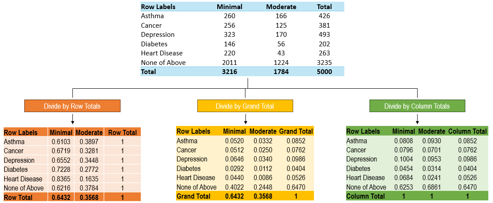

In each of these % tables, we can see how dividing by either the row, grand or column total will yield us different results. Note: we’ll be talking about conditional probabilities soon, so it’s better to have these in decimal format, rather than percentages.

Using these values, we can now talk about three types of probabilities:

1.  **Marginal probabilities** are our row and column probabilities.
    -   For example, the probability that a randomly selected person does moderate exercise, is Pr(Moderate) = 0.3568
    -   And, the probability that a randomly selected person has diabetes, is Pr(Diabetes) = 0.0404
2.  The cell values (excluding totals) within a contingency table tell us about the **joint** (or **intersection**) probabilities.
    -   For example, the probability that a randomly selected person has diabetes AND does minimal exercise, Pr(Diabetes ∩ Minimal) = 0.0292
    -   And, the probability that a randomly selected person has diabetes AND does moderate exercise, Pr(Diabetes ∩ Moderate) = 0.0112
3.  **Conditional probabilities** represent the probability of an event conditional on another event (and are our cell values divided by the row or column total).
    -   For example, the probability someone has diabetes given they do minimal exercise, is Pr(Diabetes \| Minimal) = 0.0454
    -   And, the probability someone has diabetes given they do moderate exercise, is Pr(Diabetes \| Moderate) = 0.0314

Note: We can also look at conditional probabilities row-wise as well.

-   For example, the probability someone does minimal exercise given they have Diabetes, is Pr(Minimal \| Diabetes) = 0.7228
-   And, the probability someone does moderate exercise given they have Diabetes, is Pr(Moderate \| Diabetes) = 0.2772

::: callout-warning
### Conditional Probability Formula

Mathematically, conditional probabilities can be derived from the contingency table and the following formula:

$$Pr(A|B)=\frac{Pr(A ∩ B)}{Pr(B)}$$ For example, suppose we wanted to determine the probability that someone has diabetes given they do minimal exercise.

```{r}
Exercise  |> 
  tbl_cross(row = Condition, col = Exercise) |> 
  bold_labels()
```

This becomes:

$$Pr(Diabetes|Minimal)=\frac{Pr(Diabetes ∩ Minimal)}{Pr(Minimal)}$$ $$Pr(Diabetes|Minimal)=\frac{146/5000}{3216/5000}$$ $$Pr(Diabetes|Minimal)=0.0454$$

(Note: if you look at the "Divide by Column Totals" table above, you'll see that this matches the answer here)
:::

:::: callout-tip
### Practice Exercise 1.4

Using the formula provide above, determine Pr(None of Above \| Moderate).

```{r}
Exercise  |> 
  tbl_cross(row = Condition, col = Exercise) |> 
  bold_labels()
```

::: {.callout-important collapse="true"}
### Click for Solutions

$$Pr(None|Moderate)=\frac{Pr(None ∩ Moderate)}{Pr(Moderate)}$$ $$Pr(None|Moderate)=\frac{1224/5000}{1784/5000}$$ $$Pr(None|Moderate)=0.6861$$
:::
::::

### Independence

In statistics, two categorical variables are said to be independent if the distribution of one variable does not depend on the other. In other words, knowing the value of one variable gives you no information about the value of the other. For example, if exercise habits are independent of work type, then the proportion of people who exercise regularly would be the same for both office-based and non-office workers.

Mathematically, there are a few different ways to check for independence. Two methods are shown below using our existing data set (suppose we want to check if having diabetes and amount of exercise is independent).

::: callout-warning
### Checking Independence (Method 1)

One method is to use the formula:

$$Pr(A|B_{1})=Pr(A|B_{2})=Pr(A)$$

In this example,

-   let A = Diabetes
-   B1 = Minimal Exercise
-   B2 = Moderate Exercise

Here:

-   Pr⁡(Diabetes)=0.0404
-   Pr⁡(Diabetes\|Minimal)=0.0454
-   Pr⁡(Diabetes\|Moderate)=0.0314

Therefore:

Pr⁡(Diabetes\|Minimal) ≠ Pr⁡(Diabetes\|Moderate) ≠ Pr⁡(Diabetes)

And since, these are not equal, we cannot assume independence. In other words, the likelihood of developing diabetes depends on how much exercise you do.
:::

::: callout-warning
### Checking Independence (Method 2)

Another common method for checking independence is shown here.

$$Pr(A∩B)=Pr(A)\times Pr(B)$$

In this example,

-   let A = Diabetes
-   B = Minimal Exercise (we can use either Minimal or Moderate)

Here:

-   Pr(A) = 202/5000 = 0.0404
-   Pr(B) = 3216/5000 = 0.6432
-   Pr(A∩B) = 146/5000 = .0292

And:

-   Pr(A) x Pr(B) = 0.0404 x 0.6432 = 0.0260

Compare with joint probability:

-   Does Pr(A∩B) = Pr(A) x Pr(B)?
-   0.0292 ≠ 0.0260
-   Therefore, having diabetes and amount of exercise are not independent

**Note**: If you had used *Moderate* exercise as Pr(B) instead of *Minimal* exercise, you would still make the same conclusion.
:::

**Important:** This check for independence assumes our probabilities are a good reflection of the population. Most of the time, you’ll only ever be working with sample data. In which case, we are looking for the probabilities to be approximately equal.

In later units, you will learn about these different tests and how to use them to check for independence (e.g. Chi-square Test). But for this unit, we will assume probabilities are exactly known and correct.

::: callout-tip
### Practice Exercise 1.5 (Challenge)

Suppose you draw two cards from a standard deck of 52 playing cards, **with replacement**. Are the events "first card is an Ace" and "second card is also an Ace" independent?

Begin byconstructing a 2x2 contingency table that looks something like:

|  |  |  |  |
|:-----------------|:----------------:|:----------------:|:----------------:|
|  | **2nd Card**: Ace | **2nd Card**: Not Ace | Total |
| **1st Card**: Ace | `r webexercises::fitb(16)` | `r webexercises::fitb(192)` | `r webexercises::fitb(208)` |
| **1st Card**: Not Ace | `r webexercises::fitb(192)` | `r webexercises::fitb(2304)` | `r webexercises::fitb(2496)` |
| Total | `r webexercises::fitb(208)` | `r webexercises::fitb(2496)` | `r webexercises::fitb(2704)` |

Then you can use either method from above (for practice, try both!) to check if the events "first card is an Ace" and "second card is also an Ace" independent?

:::

## Understanding Numerical data

For the rest of this chapter we will focus on numerical data.

### Measures of Central Tendency

Back when I was working in Sport Analytics, we would collect a lot of data, and build various models. However, when presenting to the Coach or Sporting Manager, quite often they only have time to listen to one piece of information about the data. In that situation, that one piece of information, should probably be a measure of central tendency:

> The center of a series of data points is usually a good example of the type of data we can expect from the group as a whole.

In general, there are 3 measures of center that people focus on: mean, median and mode.

#### Mean

The mean (average) is the most common summary measure. It adds all values and divides by the total number of observations. It provides an overall sense of the dataset’s “center.”

However, the mean is most informative when the data are normally distributed — that is, when values are symmetrically clustered around the middle, with fewer observations at the extremes (forming the familiar “bell curve”).

For example, in a class of 25 students with heights roughly balanced around 175 cm, the mean height gives a good sense of the group’s overall stature.

```{r}
library(tidyverse)

# --- Data -------------------------------------------------------------
heights <- tribble(
  ~Name,      ~Height,
  "Amber",    160,
  "Viv",      165,
  "Jane",     165,
  "Belinda",  165,
  "Tim",      170,
  "Rudy",     170,
  "Toby",     170,
  "Jeff",     170,
  "Adam",     170,
  "Trevor",   175,
  "Wendy",    175,
  "Troy",     175,
  "Carol",    175,
  "Joy",      175,
  "Pete",     175,
  "Maya",     180,
  "Zoe",      180,
  "Sandy",    180,
  "Amy",      180,
  "Sarah",    180,
  "Rick",     185,
  "Jack",     185,
  "Rose",     185,
  "Tom",      190,
  "Mike",     190
)

# Add a stacking order (so names stack vertically for each height)
heights <- heights |>
  group_by(Height) |>
  mutate(stack = row_number()) |>
  ungroup()

# Define tick marks for the number line
ticks <- tibble(x = seq(160, 190, by = 5))

# --- Plot -------------------------------------------------------------
ggplot(heights, aes(x = Height, y = stack)) +
  # number line
  geom_hline(yintercept = 0, colour = "grey80", linewidth = 1.2) +
  geom_segment(data = ticks,
               aes(x = x, xend = x, y = -0.1, yend = 0.4),
               inherit.aes = FALSE,
               colour = "grey40", linewidth = 0.7) +
  # green name boxes
  geom_tile(width = 3.5, height = 0.9, fill = "#4BA649") +
  geom_text(aes(label = Name), colour = "white", size = 3.8) +
  scale_x_continuous(breaks = seq(160, 190, 5),
                     limits = c(158, 192)) +
  coord_cartesian(clip = "off") +
  theme_minimal(base_size = 12) +
  theme(
    axis.title = element_blank(),
    axis.text.y = element_blank(),
    axis.ticks = element_blank(),
    panel.grid = element_blank()
  )


```

The middle height of this distribution is 175cm, and we can see that we have approximately the same amount of data on either side of this middle. For normal distributions, most of the data is around the middle and then becomes scarcer on either side (forming the famous bell-shaped curve you’re probably familiar with)

Now, suppose the heights of students from the classroom next door shared a normal distribution similar to the previous one. If you had to guess the height of a random student in the class (without looking at them), then selecting 175cm is your safest bet (because that’s where most of the data is).

Be careful however, as the MEAN can sometimes be misleading. For example, the mean life expectancy back in the middle ages was around 30 years. Based upon the previous example, this might lead you think that most people \[in the middle ages\] died around their 30s, and forming a normal distribution around this age (see the left panel below). Back then however, there was an incredibly high rate of child mortality in the days before modern medicine. But, those who managed to make it to 30, were able to, on average, live relatively long lives after that (well, long for the time anyway). Recall that the MEAN life expectancy in the middle ages was about 30. But if we examine this distribution (right panel below), hardly any of the data points are at the mean! Therefore, if we were to randomly select a person from the Middle Ages and guess their age of death, using the mean of the data would not be the best method.

```{r}
library(tidyverse)

# --- Simulate data ---------------------------------------------------
set.seed(123)

# Panel A: normal distribution
df_A <- tibble(
  value = rnorm(10000, mean = 30, sd = 5),
  Distribution = "A: Normal"
)

# Panel B: bimodal distribution (two normal curves combined)
df_B <- tibble(
  value = c(
    rnorm(5000, mean = 10, sd = 4),
    rnorm(5000, mean = 50, sd = 4)
  ),
  Distribution = "B: Bimodal"
)

# Combine into one dataset
df <- bind_rows(df_A, df_B)

# --- Plot -------------------------------------------------------------
ggplot(df, aes(x = value, fill = Distribution)) +
  geom_histogram(aes(y = ..density..), bins = 50, alpha = 0.6, color = "white") +
  geom_density(alpha = 0.8, color = "black", linewidth = 1) +
  facet_wrap(~Distribution, scales = "free", ncol = 2) +
  scale_fill_manual(values = c("#4BA649", "#3CAEA3")) +
  labs(
    x = "Value",
    y = "Density",
  ) +
  theme_minimal(base_size = 13) +
  theme(
    legend.position = "none",
    strip.text = element_text(face = "bold", size = 12),
    plot.title = element_text(hjust = 0.5)
  )

```

#### Median

The median is the middle value when data are ordered from smallest to largest. It divides the dataset in half — 50% of values fall below, 50% above. Because it ignores extreme values, the median is more robust when the data are skewed.

Suppose you’re a wealthy Australian student with a net worth of about \$60,000. And you find yourself in a room with seven other similarly wealthy Australian students, and Elon Musk, who is currently estimated to be worth around 400 billion dollars.

<center></center>

The mean, or average, worth of the people in the room would by slightly over 45 billion dollar. (A value that doesn’t correctly tell us anything about Musk’s actual wealth, or anyone else’s for that matter).

$$\text{Mean}_{\text{net worth}}=\frac{60000+59450+63510 \:+\:...+\:405,000,000,000}{9}=45,000,052,357$$

When there are extreme values that can inflate / deflate the center of your data, the median would be a better choice than the mean. To determine the median worth of the people in the room, you first list each individual’s worth in order. The median figure is half-way down the list. In this case, \$60,000.

```{r}
options(scipen = 999)
data.frame(
  Person = c("Elon Musk","Person 2","Person 3","Person 4","Person 5","Person 6",
             "Person 7","Person 8","Person 9"),
  NetWorth = c(450000000000,65200,63510,61000,60000,59450,55800,55060,51200)
) |> 
  regulartable() |> 
  color(i = 5, color = "red") |> 
  autofit()
```

Mathematically, we use the following formulas to determine the median position of a set of numbers (where n = number of data points):

$$\text{Median}_{\text{odd}}=(\frac{n+1}{2})^{th}$$

$$\text{Median}_{\text{even}}=\frac{(n/2)^{th}+(n/2+1)^{th}}{2}$$

For example:


**Note:** Just like the mean, the median can also be misleading depending on the nature of your data.

Suppose we had sale prices for 5 homes in Clayton (arranged in descending order). And, suppose we also have sale prices for 5 homes in Wantirna South.

<center>**Clayton**</center>

```{r}
data.frame(
  House = 1:5,
  Price = c(1480000,1470000,1460000,1320000,1270000)
) |> 
  regulartable() |> 
  color(i = 3, color = "red") |> 
  autofit()
```

<center>**Wantirna South**</center>

```{r}
data.frame(
  House = 1:5,
  Price = c(2000000,1850000,1460000,1450000,1450000)
) |> 
  regulartable() |> 
  color(i = 3, color = "red") |> 
  autofit()
```

Here, both suburbs have the same median sale price. However, it’s very clear that the houses in Wantirna South are more costly than those in Clayton! (Information about the range of sale prices are not considered when computing the median).

#### Mode

The mode is the value that occurs most frequently in a dataset. Unlike the mean or median, which describe the centre of the data, the mode identifies the most common observation. It is particularly useful when analysing categorical data (for example, determining the most popular product or preferred transport mode), though it can also be applied to numerical data. A dataset can have one mode (unimodal), more than one mode (bimodal or multimodal), or no mode at all if all values occur with equal frequency. While the mode provides insight into what is typical, it does not reflect how data are distributed around that value.

### Data Disributions

Often the mean will be different from the median, even though both are designed to describe where the data is centered. The difference is usually due to skewness in the data.

<center></center>

a.  When the mean is lower than the median, the data generally displays negative skewness. This is often due to a few small values in the left tail of the distribution.
b.  When the mean is approximately equal to the median, the data displays a symmetrical distribution. There is approximately equal number of small and large values the decrease in frequency from the center of the data.
c.  When the mean is larger than the Median, the data generally displays positive skewness. This is often due to a few large values in the right tail of the distribution.

:::: callout-tip
### Practice Exercise 2.1

In a 2008 study, researchers compared monthly online gambling expenditure across several locations. The table below summarises the findings:

```{r}
data.frame(
  Country = c("United States",
              "Canada",
              "United Kingdom",
              "Asia",
              "Australia"),
  Mean = c(237,133,65,95,300),
  Median = c(90,90,61,55,9)
)|> 
  regulartable() |> 
  autofit()
```

a.  Which country has the highest mean monthly gambling expenditure?
b.  Which country has the lowest median monthly gambling expenditure?
c.  Given the results of A. and B., what can be say about gambling expenditures in Australia?

::: {.callout-important collapse="true"}
### Click for Solutions

a.  Australia (mean = \$300)
b.  Also Australia (median = \$9)
c.  Most likely, there are some extreme cases (outliers) that are skewing the distribution to the right and increasing the mean.
:::
::::

### Measures of Spread

While measures of centrality (such as the mean or median) tell us where the centre of the data lies, measures of spread show us how tightly or loosely the data cluster around that centre. Two datasets can have the same average but very different variability — one might have values that are all similar, while another might include both very small and very large numbers. Understanding spread helps us interpret the consistency, reliability, and diversity within data. In the sections that follow, we’ll explore four key ways to describe spread: the range, interquartile range (IQR), variance, and standard deviation, each offering a different perspective on how dispersed the data are.

#### Range

Suppose you work in the Human Resources department for a particular organisation. You’ve been informed that the organisation is losing employees rapidly and you need to find a way to keep them. Your first task is to learn more about your employees.

To begin with, you could calculate the **range** of the current employees’ salaries.

> The **range** takes the largest number in the data set and subtracts the smallest number to give the distance between these two extremes.

Suppose you take a random sample of 10 employees and inspect their current annual salaries (here arranged in sequential order on a number line):

<center></center>

Subtracting the smallest number from the largest gives us the range (here: 122K – 75K = 47K)

In this case, the two larger values (115K and 122K) appear further away than the rest of the data. This might represent employees at different levels compared to the others. Including these, increases the range.

<center></center>

**Note:** the range is unreliable as a measure of spread when we have extreme cases. We’re going to need a different approach!

#### Interquartile Range

The interquartile range (IQR) measures the spread of the middle 50% of your data. It focuses on where most observations lie by looking at the distance between the 1st quartile (Q1) — the value marking the 25th percentile — and the 3rd quartile (Q3) — the value marking the 75th percentile. The IQR is calculated as $IQR = Q3-Q1$. Unlike the range, which can be heavily influenced by extreme values, the IQR is resistant to outliers and provides a clearer picture of the typical variation in your dataset. In practice, it helps us understand whether most data points are tightly clustered around the median or spread more widely across the scale.

<center></center>

One of the advantages of the IQR, is that it is not affected by extreme cases (like the Range). In this example, we’ve captured the middle 50% of our data. However, we’ve completely ignored the data in the tails! (i.e. the bottom and top 25% of the data)

#### Variance

The variance measures how much the values in a dataset differ from the mean. It does this by calculating the average of the squared deviations — that is, how far each data point is from the mean, squared to remove negative signs and emphasise larger differences. Mathematically, the variance is given by:

$$\frac{1}{n - 1} \sum_{i=1}^{n} (X_i - \bar{X})^2$$ Click on the steps below to see how the variance is calculated:

The formula looks more complicated than it really is. In essence what we are doing is:

1.  Computing the mean of the data set
2.  Subtracting the mean from each value (this is called a deviation)
3.  Squaring eaching deviation
4.  Adding up these squared deviations
5.  Dividing by n - 1

The image below shows how the variance is computed for our current data set using these steps:


Note that because we squared the deviations, our units are squared as well! (Most people don’t think of things in squared terms, so we need a way to convert this back to original units)

#### Standard deviation

The Standard Deviation (SD) is the square root of the variance, which gives back the units that we’re comfortable with and you can think of the SD as the average amount we expect a point to differ (or deviate) from the mean.


:::: callout-tip
### Practice Exercise 2.2

Suppose we randomly sampled the final grades of ETC1000 students from different years (and arranged in ascending order for each year):

|           |     |     |     |     |     |     |     |     |     |     |
|-----------|-----|-----|-----|-----|-----|-----|-----|-----|-----|-----|
| **2022:** | 24  | 56  | 57  | 66  | 66  | 68  | 75  | 78  | 84  | 90  |
| **2023:** | 45  | 46  | 46  | 47  | 49  | 51  | 53  | 54  | 55  | 55  |
| **2024:** | 65  | 65  | 65  | 67  | 69  | 70  | 72  | 72  | 74  | 75  |

a.  Based on these samples, which year (2022, 2023 or 2024) had the most spread in final grades?
b.  Based on the final grades across the three years, which year appears to have been the most difficult for students?
c.  Suppose I’m a repeat student and scored a 45 in each of the three years. In which year would I have performed the worst relative to my peers?

::: {.callout-important collapse="true"}
## Click for Solutions

a.  2022
b.  2023
c.  2024
:::
::::

### Visualisations

#### Boxplots

When exploring numerical data, one of the most effective ways to summarise and visualise the distribution is through a boxplot (also known as a box-and-whisker plot). Boxplots are built from a set of five key statistics — collectively known as the five-number summary.

The five-number summary provides a concise overview of your dataset’s spread and shape. It consists of:

1.  Minimum – the smallest observed value (excluding outliers).
2.  First Quartile (Q1) – the value below which 25% of the data fall.
3.  Median (Q2) – the middle value, dividing the dataset into two equal halves.
4.  Third Quartile (Q3) – the value below which 75% of the data fall.
5.  Maximum – the largest observed value (excluding outliers).

Together, these five values tell us where the data begin, where they end, and how they are distributed around the middle. The interquartile range (IQR), which we discussed earlier, is simply the distance between Q3 and Q1 — representing the spread of the middle 50% of the data.

Boxplots are particularly useful when comparing groups side-by-side. They allow you to quickly see differences in central tendency, spread, and symmetry. For instance, if one group’s box is much taller, it has more variability; if the median line is closer to one end of the box, the data are skewed.

```{r}
library(tidyverse)
library(scales)

set.seed(123)

# Target medians (log-normal: median = exp(meanlog))
medians <- c(Warehouse = 50000, Office = 75000, Managers = 110000)

# Sample sizes and variability (sdlog controls spread; tweak as desired)
n_group <- c(Warehouse = 200, Office = 200, Managers = 120)
sdlog   <- c(Warehouse = 0.22, Office = 0.25, Managers = 0.28)

# Simulate salaries with desired medians
sim_df <- map2_dfr(names(medians), names(medians), ~{
  tibble(
    Group  = .x,
    Salary = rlnorm(n_group[.x], meanlog = log(medians[.x]), sdlog = sdlog[.x])
  )
})

# Order groups on the x-axis
sim_df <- sim_df |> mutate(Group = factor(Group, levels = c("Warehouse", "Office", "Managers")))

# Side-by-side boxplots
ggplot(sim_df, aes(x = Group, y = Salary, fill = Group)) +
  geom_boxplot(outlier.alpha = 0, width = 0.6) +
  scale_y_continuous(labels = dollar_format(prefix = "$")) +
  scale_fill_manual(values = c("#6BAED6", "#74C476", "#FD8D3C")) +
  labs(
    # title = "Salary Distributions by Role",
    x = NULL, y = "Annual Salary"
  ) +
  theme_minimal(base_size = 13) +
  theme(
    legend.position = "none",
    panel.grid.minor = element_blank()
  )

```

#### Histograms

Last week, we learnt how to transform raw data into a frequencies table, which in turn could be visualised as a bar chart. This works well when you have categorical data, because you are determining how often a category occurs.

```{r}
data.frame(
  Condition = c("Asthma","Diabetes","None"),
  Frequency = c(75, 47, 256)
) |> 
  ggplot(aes(Condition, Frequency)) +
  geom_col() +
  geom_text(aes(label = Frequency),
            vjust = 1.5,
            color = 'white')
```

It’s a bit more challenging when you have numerical data. For example, let’s consider our salary case study again, where we have a range of numeric values (instead of categories), and each value only has a count of 1.

```{r}
data.frame(
  Salary = c(75000,81000,86000,87000,91000,93000,99000,102000,115000,112000),
  Frequency = c(1,1,1,1,1,1,1,1,1,1)
) |> 
  regulartable() |> 
  autofit()
```

Now, you could treat each value as it’s distinct category, and then get the frequencies of each. You can then plot a bar chart to visualise this. Unfortunately, this plot doesn’t tell us much at all!

```{r}
data.frame(
  Salary = c(75000,81000,86000,87000,91000,93000,99000,102000,115000,112000),
  Frequency = c(1,1,1,1,1,1,1,1,1,1)
) |> 
  ggplot(aes(factor(Salary), Frequency)) +
  geom_col() +
  geom_text(aes(label = Frequency),
            vjust = 1.5,
            color = 'white') +
  xlab("Salary")
```

Instead of using every single value in the data set as a category, people **bin** values together. This means to group data points close to each other into groups.

<center></center>

In this sample we have 125 employee salaries in total, and we can see that the most frequent salaries were between $63,243$ and $86,121$. We can also say that very few employees (n = 4) have salaries less than $55,617$. Likewise, very few employees (n = 3) have salaries above $93,747$.

### Probability Distributions

Another way to think about these plots is not in terms of how often a value actually occurred, rather – how likely is it that a value would occur (i.e. the probability). Imagine you were part of the HR team and you were doing a campaign that awards prizes to random employees. Your manager asks you the following question:

> How likely is it that a randomly selected employee will have a salary greater than \$93,747?

If we look at the frequency distribution, we’d probably respond “not very likely” ($\frac{3}{125} = .024$).

On the other hand, if your manager asked you

> How likely is it that a randomly selected employee will have a salary between \$63,243 and \$86,121?

If we look at the frequency distribution, we’d probably respond “very likely” ($\frac{24+42+33}{125}=.792$).

For any distribution of values, we can (in theory) calculate the probability of obtaining a value of any given size. For each distribution, statisticians have computed probability density functions, that specify idealised versions of each distribution. Plotting these, provides us with curves (see above), known as probability distributions. A probability distribution is similar to a histogram, however the lumps and bumps have been smoothed out.

<center></center>

Let's just focus on our salary data for now, which appears to approximate a normal distribution based on its histogram:

<center></center>

#### Properties of the normal distribution

1.  The Normal curve is bell shape and approximately symmetric about the mean
2.  The mean, median and mode are approximately equal
3.  The total area under the curve is equal to 1

The standard deviation can be used to express how far from the mean the data values are. We usually discuss the normal distribution with respects to 1SD above and below the mean, 2SD above and below the mean, and 3SD above and below the mean. However we could also talk about 4SD, 5SD, etc. above and below the mean. This is because the normal distribution never touches the x-axis (i.e. it approaches ± ∞).

Remember earlier that the area under the normal distribution equals 1? This is useful because the area (probability) under the curve will always be the same for different SD above / below the mean for the standard normal distribution.

<center></center>

From the image above, we can see that:

-   68.3% of the area is covered within 1 std. deviation of the mean
-   95.4% of the area is covered within 2 std. deviations of the mean
-   99.7% of the area is covered within 3 std. deviations of the mean

Let's reconsider our salary example from before, shown below as normal probability density functions (PDF), for office and warehouse workers.

<center></center>

We can see that the center of the distributions for both group is approximately the same (\~ 50,000), however we can see that there is very different spread for both distributions. On average, warehouse and office workers have similar salaries, however, the variability in office worker’s pay is much larger. Let's assume:

-   Office \~ N(50000, 10000)
-   Warehouse \~ N(50000, 5000)

Now suppose we randomly selected an employee from both groups who have annual salaries of $60,000$. In both cases, we’re looking at an employee who’s 5000 above the mean salaries for their groups. But relative to each group’s spread, the $60,000$ Office worker is not that much higher compared to other Office workers. Whereas the $60,000$ warehouse worker is much higher than other warehouse workers.

<center></center>

This is why we **standardise** values - so that we can interpret these values in context. By standardising, we convert the data to a common scale: the standard normal distribution, which has a mean of 0 and a standard deviation of 1. This is called a Z transformation.

For any value X, the z-score is calculated as:

$$z=\frac{X-\mu}{\sigma}$$

Where:

-   X: the value of interest
-   $\mu$: the population mean
-   $\sigma$: the population standard deviation

This formula standardises the value X, putting it on a common scale with mean 0 and standard deviation 1. For example, using our scenario from above (selecting an office worker with a salary of $60,000$), we can standardise this using the Z formula. Recall, the $\mu=50,000$ and $sigma=10,000$.

$$Z=\frac{60000-50000}{10000}=1.00$$

Once you have converted a raw value X into its corresponding z-score, the next step in many statistical problems is to determine how likely that value is under the assumption of a normal distribution. In practice, this means translating the z-score into an area under the standard normal curve. You might recall a table similar to the one below from high school:


In our example, the Z score is 1.00. Using the table, we can see that this corresponds to a probability of 0.8413. This tells us that for an office worker with a salary of 60,000:

-   0.8413 (or 84.13%) of office workers have salaries below 60,000
-   0.1587 (or 15.87%) of office workers have salaries above 60,000. This is because probabilities need to sum to 1.

If we repeated this for warehouse workers as well:

<center></center>

## Workshp Exercises

In the previous chapter we merged together several data sets to create a single workbook. We will use this data for the exercises in this chapter. If you did not save your combined data file, you can download it again here:

<br><center>
```{r, echo=FALSE, message=FALSE}
library(downloadthis)
download_file(
  path = "data/Business Profits.xlsx",
  button_label = "Combined Data",
  button_type = "success"
)
```
</center>
<br>


### Exercise 1

Follow along with the teacher to complete the following tasks:

a. In Column M: create a new variable called 'Profit_Category' by using the current `profit` variable. If `profit` < 0, classify it as 'no profit', otherwise 'profit'.

```{r, eval=FALSE, echo=TRUE}
=IF(proft < 0, "no profit", "profit")
```

b. Create a Pivot Table to determine how many businesses made a profit, and how many did not.

::: {.callout-note collapse="true"}

#### Check Answer

<center>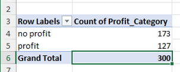</center>

:::

c. Convert the counts from the previous pivot table to percentages

::: {.callout-note collapse="true"}

#### Check Answer

<center>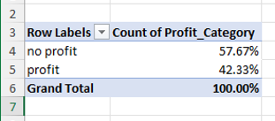</center>

:::

d. Add `industry_sector` as a filter. Try out the filter, can you explain what it does?

::: {.callout-note collapse="true"}

#### Check Answer

<center>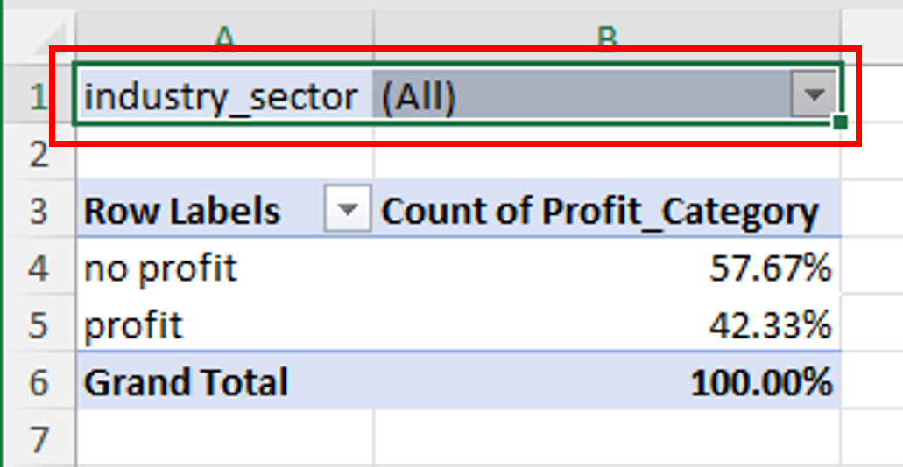</center>

:::

e. Add a pivot bar chart that links to the pivot table (i.e. if you make changes to the table, the chart will update automatically).

::: {.callout-note collapse="true"}

#### Check Answer

<center>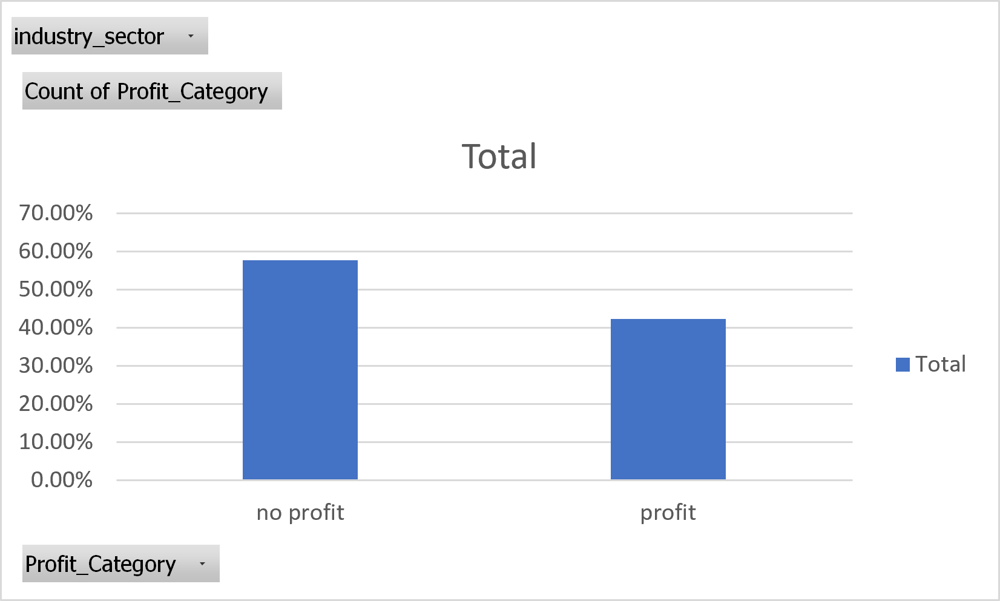</center>

:::

f. Now add 'has_online_store` to your pivot table. This should update the  chart as well. Make sure you are able to interpret what the values in the table mean.

::: {.callout-note collapse="true"}

#### Check Answer

<center>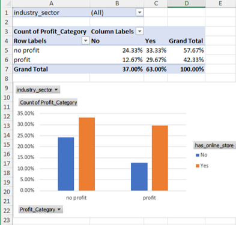</center>

:::

g. Now indert a slicer for your pivot table. Choose `industry_sector`. Click on the different levels of your slicer and your table and chart should update automatically.

::: {.callout-note collapse="true"}

#### Check Answer

<center>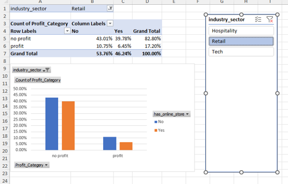</center>

:::

### Exercise 2

Now it's your turn. Choose another categorical variables and explore how it is related to **Profit_Category**. Also include `industry_sectory` as a filter so that your slicer can interact with this one as well.

The other categorical variables are:

- `has_online_store`
- `uses_ai`
- `brand_recognition`

### Exercise 3

We will now use the results of our first pivot table to complete some probability questions. These are the same questions we saw in the lecture, so try to solve these using Excel only.

**Marginal probabilities**

a.  What is the probability that a randomly selected business made a profit?
b.  What is the probability that a randomly selected business has an online store?

**Joint probabilities**

c.  What is the probability that a randomly selected business made a profit AND has an online store?
d.  What is the probability that a randomly selected business made no profit AND does not have an online store?

**Conditional probabilities (column-wise)**

e.  What is the probability that a business made a profit, given that it has an online store?
f.  What is the probability that a business made a profit, given that it does not have an online store?

**Conditional probabilities (row-wise)**

g.  What is the probability that a business has an online store, given that it made a profit?
h.  What is the probability that a business has an online store, given that it made no profit?

**Independence**

i. Using conditional probabilities, check if making a profit and having an online store are independent events


### Exercise 4

We will now use the data analysis tool pack to generate descriptive statistics for numerical data. First, we need to enable the toolpack:

#### Analysis ToolPak in Excel

::: panel-tabset
Follow the instructions below to enable the ToolKit (depending on your operating system)

##### Windows

1.  Click the **File** tab, click Options, and then click the **Add-Ins** category.

2.  In the **Manage** box, select **Excel Add-ins** and then click **Go**.

    If you're using Excel for Mac, in the file menu go to Tools \> Excel Add-ins.

3.  In the **Add-Ins** box, check the **Analysis ToolPak** check box, and then click **OK**.

    -   If **Analysis ToolPak** is not listed in the **Add-Ins available** box, click **Browse** to locate it.

    -   If you are prompted that the Analysis ToolPak is not currently installed on your computer, click **Yes** to install it.

##### macOS

1.  Click the **Tools** menu, and then click **Excel Add-ins**.

2.  In the **Add-Ins available** box, select the **Analysis ToolPak** check box, and then click **OK**.

    a.  If Analysis ToolPak is not listed in the Add-Ins available box, click Browse to locate it.

    b.  If you get a prompt that the Analysis ToolPak is not currently installed on your computer, click Yes to install it.

    c.  Quit and restart Excel.

    Now the Data Analysis command is available on the Data tab.
:::

If done correctly, when you switch to the **Data** tab on the ribbon, you will see the **Data Analysis** Module:

<br>

<center>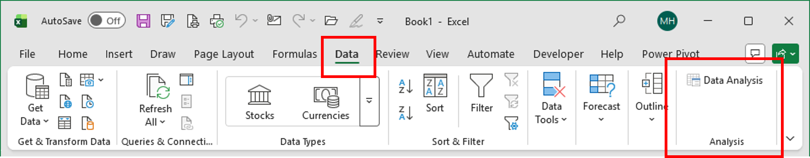</center>

<br>

a. Now follow along with the teacher to obtain descriptive statistics for the variable `profit`.

b. Filter the data for when `has_online_store` is "no". Copy the `profit` data under this condition to a new sheet.

c. Repeat step c, except now change the filter to "yes".

d. Using the data analysis tool pack, obtain descriptive statistics for profit under these two filters.

::: {.callout-note collapse="true"}

#### Check Answer

<center>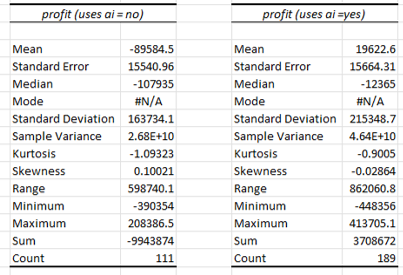</center>

:::

e. Create a boxplot to visualise this relationship

::: {.callout-note collapse="true"}

#### Check Answer

<center>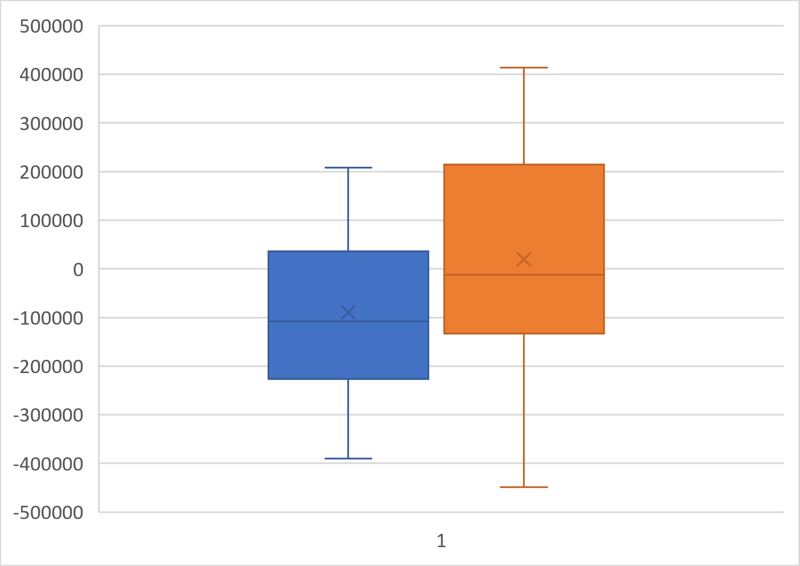</center>

:::

### Exercise 5

Now it's your turn. Hint: reset your filter first.

a. Obtain descriptive statistics for another numeric variable, e.g.:
  - `year`
  - `opertating_costs`
  - `complaint_rate`
  - `marketing_spend`
  
b. Then filter the data by `uses_ai`, for both "no" and "yes" categories, and obtain descriptive statistics.

c. Create a visualisation for your data, e.g. a boxplot, histogram, etc.

### Exercise 6

In business analytics, we sometimes use a Normal distribution as a simple approximation for profit variation within a group.

For this task, we will **assume** (as an approximation) that:

$$
X=(\text{profit} \mid \text{profit\_cat}=\text{Yes}) \sim N(\mu=178000,\ \sigma=113000)
$$

Note: for the questions below, solve using use Excel's `NORM.DIST()` and `NORM.INV()` functions.

::: callout-note

#### **The NORM.DIST() function in Excel**

Excel’s `NORM.DIST()` function calculates probabilities from a Normal distribution.

The function has the form:

> NORM.DIST(x, mean, standard_dev, cumulative)

- `x` is the value at which the distribution is evaluated  
- `mean` is the mean of the Normal distribution ($\mu$)  
- `standard_dev` is the standard deviation of the distribution ($\sigma$)  
- `cumulative` is a logical value:
  - `TRUE` returns the cumulative probability $P(X \le x)$
  - `FALSE` returns the height of the Normal density at `x`
  
:::

<br>

:::  callout-note
#### **The NORM.INV() function in Excel**

Excel’s `NORM.INV()` function returns the value corresponding to a given cumulative probability from a Normal distribution.

The function has the form:

> NORM.INV(probability, mean, standard_dev)

- `probability` is a value between 0 and 1  
- `mean` is the mean of the Normal distribution ($\mu$)  
- `standard_dev` is the standard deviation of the distribution ($\sigma$)

`NORM.INV()` is used to find **cut-off values** or **percentiles**, such as the top 5% or bottom 1.5% of observations.

:::

<br>

a. For a profitable business, what is the probability that profit is less than \$20,000?

$$
P(X < 20000)
$$


::: {.callout-note collapse="true"}

#### Check Answer

```{r, echo=TRUE, eval=FALSE}
=NORM.DIST(200000, 178000, 113000, TRUE)
```

:::

b. For a profitable business, what is the probability that profit is more than $200,000?  
That is:

$$
P(X > 200000)=1-P(X \le200000)
$$

::: {.callout-note collapse="true"}

#### Check Answer

```{r, echo=TRUE, eval=FALSE}
=1 - NORM.DIST(200000, 178000, 113000, TRUE)
```

:::

c. For a profitable business, what is the probability that profit is between \$50,000 and \$120,000?

$$
P(50000 < X \le 120000) = P(X \le 120000) - P(X \le 50000)
$$

::: {.callout-note collapse="true"}

#### Check Answer

```{r, echo=TRUE, eval=FALSE}
=NORM.DIST(120000, 178000, 113000, TRUE) - NORM.DIST(50000, 178000, 113000, TRUE)
```

:::

d. Find the cutoff value $c$ for the top 5% of profits among profitable businesses:

$$
P(X \le c)=0.95
$$

::: {.callout-note collapse="true"}

#### Check Answer

```{r, echo=TRUE, eval=FALSE}
=NORM.INV(0.95, 178000, 113000)
```

:::


